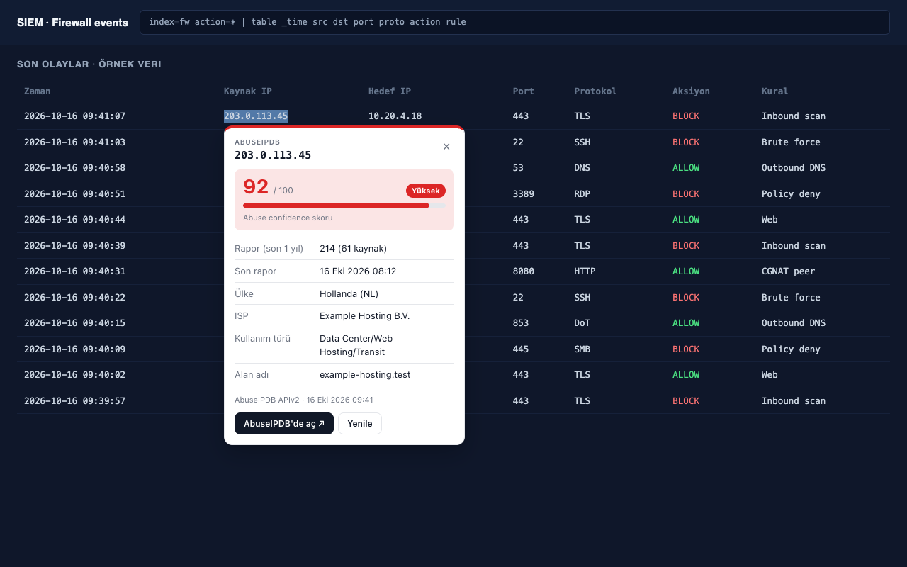

# IP Critical Scorer

Sayfada seçtiğiniz IP adresinin AbuseIPDB itibar skorunu aynı sayfada küçük bir kartta gösteren tarayıcı eklentisi. Chromium tabanlı tarayıcılar (Chrome, Edge, Brave) ve Firefox için ayrı paketleri vardır. SOC analistlerinin log, SIEM ve ticket ekranlarında sekme değiştirmeden IP itibarına bakması için yapıldı.

> Bu eklenti AbuseIPDB'nin resmi ürünü değildir ve AbuseIPDB ile bağlantısı yoktur. Veriler AbuseIPDB'nin herkese açık APIv2'sinden, sizin API anahtarınızla alınır.



Her özelliğin nasıl çalıştığının ayrıntılı anlatımı: [docs/NASIL-CALISIR.md](docs/NASIL-CALISIR.md)

## Ne yapar

- Bir IP adresini mouse ile seçtiğinizde yanında **IP'yi sorgula** butonu çıkar. Seçim tek başına hiçbir istek göndermez; sorgu yalnızca butona bastığınızda yapılır.
- Kartta şunlar gösterilir: abuse confidence skoru (0–100), rapor sayısı ve kaç farklı kaynaktan geldiği, son rapor tarihi, ülke, ISP, kullanım türü, alan adı, Tor ve beyaz liste bilgisi.
- IPv4 ve IPv6 desteklenir. `8.8.8[.]8`, `8.8.8.8:443`, `[2001:db8::1]:443` gibi yazımlar da tanınır.
- Özel ve yerel adresler (`10.x`, `192.168.x`, `127.x`, `fe80::`, CGNAT, dokümantasyon aralıkları vb.) dışarı gönderilmez; kartta adresin türü açıklanır.
- API anahtarı girilmemişse kart, AbuseIPDB'deki detay sayfasına bağlantı verir.
- Birden fazla IP içeren bir log satırını ya da tabloyu seçerseniz hepsi tek seferde sorgulanır (toplu sorgu).
- Sonuçlar notunuzla birlikte Excel'e kopyalanır; tüm sorgular yerel geçmişte birikir ve vardiya sonunda toplu aktarılabilir.

## Kurulum

Eklenti tarayıcıların kendi mağazalarından dağıtılır; güncellemeleri tarayıcı kendisi yapar.

**Chrome / Edge / Brave**
1. Chrome Web Store sayfasını açın (bağlantı mağaza onayından sonra eklenecek).
2. **Chrome'a ekle**'ye basın.
3. Araç çubuğundaki yapboz simgesinden eklentiyi sabitleyin, böylece **IP** simgesi her zaman görünür.

**Firefox (140 ve üstü)**
1. addons.mozilla.org sayfasını açın (bağlantı onaydan sonra eklenecek).
2. **Firefox'a ekle**'ye basın. Firefox, eklentinin seçtiğiniz IP'yi ve API anahtarınızı AbuseIPDB'ye gönderdiğini kurulumda gösterir.
3. Araç çubuğundaki yapboz simgesinden eklentiyi sabitleyin.

### Kurumsal ortam (BT ekibi için)

Şirket Chrome'u eklentileri politika ile sınırlıyorsa BT ekibi eklentinin kimliğini (ID) izin listesine ekler. ID, mağaza sayfasının adresinin sonundaki 32 karakterlik değerdir.

- **Yalnızca izin vermek:** `ExtensionInstallAllowlist` listesine `<eklenti-id>` eklenir.
- **Herkese zorunlu kurmak:** `ExtensionInstallForcelist` listesine `<eklenti-id>;https://clients2.google.com/service/update2/crx` eklenir.
- **Firefox:** Kurumsal politikada (`policies.json` ya da GPO) `ExtensionSettings` altında `ip-critical-scorer@zaferhamzak.github.io` kimliği için `installation_mode: "force_installed"` ve AMO'daki `install_url` tanımlanır.

Politikalar Intune, Group Policy, Jamf ya da Google Admin konsolundan dağıtılabilir. Kurulum ve güncelleme Chrome'un kendisi tarafından yapılır; bilgisayarda ek betik ya da arka plan görevi çalışmaz.

## İlk ayarlar

### 1. Sitede etkinleştirme

Eklenti, güvenlik gereği yalnızca izin verdiğiniz sitelerde çalışır.

- IP'leri gördüğünüz sayfayı (SIEM, log ekranı vb.) açın.
- Araç çubuğundaki **IP** simgesine tıklayın, **Bu sitede etkinleştir** butonuna basın ve izni onaylayın.
- **Sayfayı yenileyin.**

Birden fazla siteyi ya da tüm siteleri ayarlar sayfasından yönetebilirsiniz: simge → **Tüm ayarlar** → **Site erişimi**.

### 2. API anahtarı (isteğe bağlı, önerilir)

Skor ve rapor bilgisini kartta görmek için ücretsiz bir AbuseIPDB API anahtarı gerekir.

1. [abuseipdb.com](https://www.abuseipdb.com/) adresinde ücretsiz hesap açın.
2. Hesabınızda **Account → API** bölümünden bir anahtar oluşturun.
3. Araç çubuğundaki **IP** simgesine tıklayın, anahtarı yapıştırın ve **Kaydet**'e basın.

Anahtar yalnızca bu tarayıcıda saklanır, ekranda tekrar gösterilmez ve yalnızca `api.abuseipdb.com` adresine gönderilir.

## Kullanım

1. Etkinleştirdiğiniz bir sayfada bir IP adresini mouse ile seçin (çift tıklama ya da sürükleme).
2. Çıkan **IP'yi sorgula** butonuna basın.
3. Kartı kapatmak için kartın dışına tıklayın, **Esc**'ye basın ya da **×** butonunu kullanın.

Klavye kısayolu: IP seçiliyken **Alt+Shift+A** (Mac'te **Option+Shift+A**). Kısayolu `chrome://extensions/shortcuts` adresinden değiştirebilirsiniz.

### Toplu sorgu

Birden fazla IP içeren bir metni (log satırı, tablo satırları) seçin; buton **N IP'yi sorgula** olarak çıkar.
- En fazla 50 IP alınır. Özel adresler sorgulanmaz, kartta türleri yazılır.
- 10'dan fazla genel IP varsa kart, günlük haktan kaç sorgu düşeceğini gösterip onay ister.
- Sonuçlar listede skor rengiyle görünür. Bitince bir not seçip **Hepsini Excel'e kopyala** ile her IP için bir satır kopyalanır.
- API anahtarı yoksa, geçersizse ya da günlük hak biterse sorgu durur.

Seçimde tek bir IP geçiyorsa (ör. `src=8.8.8.8:443`) normal tekli kart açılır.

### Not ekleyerek kopyalama

Kartta hazır notlardan birine tıklayın (varsayılanlar: “False positive”, “Bloklandı”, “İzlemeye alındı”, “İncelendi, aksiyon yok”) ya da kendi notunuzu yazın. Not, Excel satırında **Not** sütununa girer ve geçmişe de kaydedilir. Hazır notları ayarlardaki Excel bölümünden düzenleyebilirsiniz.

### Klavye kısayolları

| Tuş | İş |
|---|---|
| Alt+Shift+A (Mac: Option+Shift+A) | Seçili IP'yi ya da IP'leri sorgula |
| C | Excel'e kopyala (toplu kartta hepsini) |
| O | AbuseIPDB'de aç |
| R | Yenile |
| 1–9 | Sıradaki hazır notu seç |
| N | Not alanına geç; not yazıp Enter'a basınca kopyalar |
| Esc | Kartı kapat |

Örnek akış, fareye dokunmadan: IP'yi seç → Alt+Shift+A → 2 → C.

### Sorgu geçmişi

Başarılı her sorgu yalnızca bu tarayıcıda saklanır (varsayılan 7 gün, en fazla 500 IP, aynı IP tekrar sorgulanırsa en güncel hali kalır). Araç çubuğu simgesi → **Sorgu geçmişi** sayfasında:
- Bugün / tümü filtresi ve arama (IP, ISP, ülke, not)
- Seçilenleri ya da görünenleri Excel şablonunuzla tek seferde kopyalama
- CSV indirme (Excel'in Türkçe karakterleri doğru açması için UTF-8 BOM ve noktalı virgül)
- Notları sonradan düzenleme, seçilenleri silme, geçmişi temizleme

Geçmiş kaydını ve süresini ayarlardan değiştirebilirsiniz.

### Sayfada bilinen IP'leri işaretleme (isteğe bağlı)

Ayarlardan açarsanız, daha önce sorguladığınız IP'ler izin verdiğiniz sitelerde skor rengiyle (kırmızı, turuncu, yeşil, gri) altı çizili görünür. Yeni sorgu yapılmaz, hak harcanmaz. Sayfa metni yalnızca bu tarayıcıda IP aramak için taranır ve sayfanın kendi yapısı değiştirilmez. Bu özellik Chrome 105 ve üstünde çalışır; desteklemeyen tarayıcılarda ayar kapalı görünür.

### Kalan günlük hak

Her sorgudan sonra AbuseIPDB'nin bildirdiği kalan günlük hak kartın altında ve araç çubuğu penceresinde görünür (ör. “Kalan hak: 874 / 1.000”). %10'un altına düşünce turuncu olur. Bu bilgi için ek sorgu yapılmaz.

Kartta:
- **AbuseIPDB'de aç** IP'nin AbuseIPDB sayfasını yeni sekmede açar. Raporların ayrıntısı ve daha eski kayıtlar oradadır.
- **Excel'e kopyala** sonucu tek satır olarak kopyalar (aşağıya bakın).
- **↻** sonucu AbuseIPDB'den tekrar alır.

### Excel'e kopyalama

Sorgu sonuçlarını Excel'de kayıt altına alıyorsanız, kartta **Excel'e kopyala**'ya basın ve Excel'de satırın ilk hücresine yapıştırın; her alan kendi sütununa düşer.

Sütunları kendi tablonuza göre ayarlar sayfasındaki **Excel kopyalama şablonu** bölümünden düzenleyin:
- Alan ekleyip çıkarın, ↑ ↓ ile sıralayın, başlıkları yeniden adlandırın.
- Tablonuzdaki “Analist”, “Ticket No” gibi sütunlar için **özel sütun** ekleyin. Sabit bir değer (ör. adınız) yazabilir ya da boş bırakabilirsiniz.
- **Başlık satırını kopyala** ile yeni bir tabloya başlıkları tek seferde yapıştırın.
- Boş değerlerin nasıl yazılacağını (boş, “Bilinmiyor”, “-”) ve ayırıcıyı (Excel için sekme, CSV için noktalı virgül) seçin.

Kullanılabilen alanlar: sorgu zamanı, IP, IP (defang, ör. `203[.]0[.]113[.]45`), abuse skoru, risk seviyesi, rapor sayısı, kaynak sayısı, son rapor, ülke, ülke kodu, ISP, kullanım türü, alan adı, hostname, Tor, beyaz liste, rapor dönemi, AbuseIPDB bağlantısı, not.

Tarihler `16.10.2026 09:41` biçimindedir. `=`, `+`, `-` ya da `@` ile başlayan metinlerin başına Excel'in formül olarak çalıştırmaması için `'` eklenir. Kopyalama tamamen tarayıcınızda yapılır; hiçbir yere veri gönderilmez.

### Skoru doğru okumak

- Skor 0 olması IP'nin **güvenli olduğunu kanıtlamaz**; yalnızca AbuseIPDB'de güncel kötüye kullanım raporu bulunmadığını gösterir.
- Renkler: 0 gri, 1–24 yeşil, 25–74 turuncu, 75–100 kırmızı.
- Yanıtta olmayan bilgiler "Bilinmiyor" olarak gösterilir; hiçbir değer uydurulmaz.

## Ayarlar

| Ayar | Varsayılan | Açıklama |
|---|---|---|
| Rapor dönemi | 365 gün | Rapor sayısı ve son rapor tarihi bu dönemi kapsar. AbuseIPDB API en fazla 365 güne izin verir. |
| Önbellek süresi | 15 dakika | Aynı IP bu süre içinde tekrar sorgulanmaz. Önbellek tarayıcı kapanınca silinir. |
| Site erişimi | Hiçbiri | Eklentinin çalışacağı siteler. |
| Excel kopyalama şablonu | 13 sütun | Kopyalanan satırın sütunları ve sırası. |
| Hazır notlar | 4 not | Kartta tek tıkla seçilen notlar. |
| Sorgu geçmişi | Açık, 7 gün | Yerel geçmiş ve saklama süresi (1–90 gün). |
| Bilinen IP'leri işaretleme | Kapalı | Daha önce sorgulanan IP'leri sayfada renklendirir. |

### Ayarları ekiple paylaşma

Ayarlar → **Ayarları paylaş** → **Ayarları dışa aktar** ile Excel şablonu, hazır notlar, süreler ve site listesi bir JSON dosyasına kaydedilir. Ekip arkadaşınız **Ayar dosyası içe aktar** ile yükler; site izinleri için ayrıca bir onay butonu çıkar. API anahtarı ve sorgu geçmişi dosyaya girmez.

## Limitler

Ücretsiz AbuseIPDB hesabında **günde 1.000 sorgu** hakkı vardır. Eklenti bu hakkı korumak için:

- Aynı IP'yi önbellek süresi içinde tekrar sorgulamaz.
- Aynı anda yapılan aynı IP sorgularını tek isteğe indirir.
- Özel adresleri ve geçersiz seçimleri hiç göndermez.
- Limit dolduğunda (HTTP 429) AbuseIPDB'nin bildirdiği süre boyunca istek atmaz ve kartta ne zaman tekrar denenebileceğini gösterir.

## Gizlilik

Ayrıntılı metin: [PRIVACY.md](PRIVACY.md)

- Yalnızca seçilen ve doğrulanan IP adresi ile API anahtarınız `api.abuseipdb.com` adresine gönderilir.
- Sayfanın adresi, içeriği, log metni ya da çerezler hiçbir yere gönderilmez.
- Telemetri ya da analiz yoktur; geliştiriciye hiçbir veri gitmez.
- Sorgu geçmişi, notlar ve kalan hak bilgisi yalnızca bu tarayıcıda tutulur.
- Bilinen IP'leri işaretleme açıksa sayfa metni yalnızca yerelde IP aramak için taranır; hiçbir yere gönderilmez.
- API anahtarı tarayıcının yerel eklenti depolamasında tutulur; web sayfaları erişemez.
- Chromium'da eklentinin sayfalara eklenen kendi bileşeni bile anahtarı okuyamaz; anahtarı yalnızca arka plan servisi kullanır. Firefox bu kısıtlamayı (`storage.setAccessLevel`) desteklemediği için Firefox'ta bu ek koruma yoktur.

## İzinler ve gerekçeleri

| İzin | Neden gerekli |
|---|---|
| `storage` | Ayarları, API anahtarını ve önbelleği saklamak |
| `scripting` | Seçim butonunu yalnızca izin verilen sitelere eklemek |
| `activeTab` | Simgeye tıklandığında o sitenin etkin olup olmadığını göstermek |
| `api.abuseipdb.com` | Sorgu isteğini göndermek |
| Site izinleri (isteğe bağlı) | Yalnızca sizin seçtiğiniz sitelerde çalışmak |

## Sorun giderme

- **Buton çıkmıyor:** Simgeye tıklayıp sitenin etkin olduğunu kontrol edin ve sayfayı yenileyin. Eklenti sayfa içindeki çerçevelerde (iframe) de çalışır; ancak çerçeve başka bir alan adından geliyorsa o alan adına da ayarlar → Site erişimi bölümünden izin verin.
- **"Eklenti yeniden yüklenmiş" mesajı:** Eklenti güncellendiğinde açık sayfalarda görülebilir; sayfayı yenileyin.
- **401 hatası:** API anahtarı yanlış ya da iptal edilmiş. Simgeden yeni anahtar girin.

## Geliştirme

Gereksinim: Node.js 20 veya üstü. Ek bağımlılık yoktur.

```sh
npm test          # birim testleri
npm run sync      # chromium/src -> firefox/src
npm run package   # senkronlar, testleri çalıştırır, dist/ altına iki mağaza ZIP'i üretir
```

Klasör yapısı:

```
chromium/                 Chrome, Edge, Brave paketi
  manifest.json           service worker arka planı
  src/                    kaynak kodun asıl yeri
  icons/
  web-store/              Chrome Web Store başvurusunun tüm alanları ve görselleri
firefox/                  Firefox paketi
  manifest.json           event page arka planı, gecko kimliği, veri beyanı
  src/, icons/            chromium/'dan kopyalanır, elle düzenlenmez
  store-assets/           addons.mozilla.org metinleri
design/icons/             ikonların SVG kaynakları
scripts/                  sync-src.sh, package.sh
tests/                    birim testleri (chromium/src üzerinde) ve iki paketin uyum testleri
```

Kod yalnızca `chromium/src` altında düzenlenir. `npm run sync` bunu `firefox/` altına kopyalar; testler iki klasör farklılaşırsa hata verir. Kod iki tarayıcıda da `shared/ext.js` üzerinden çalışır (Firefox'ta `browser`, Chromium'da `chrome`).

Geliştirirken yükleme:
- **Chrome:** `chrome://extensions` → **Geliştirici modu** → **Paketlenmemiş öğe yükle** → `chromium/` klasörü.
- **Firefox:** `about:debugging#/runtime/this-firefox` → **Geçici eklenti yükle** → `firefox/manifest.json`. Geçici eklenti Firefox kapanınca kaldırılır.

### Yeni sürüm yayınlama

1. `chromium/manifest.json` ve `firefox/manifest.json` içindeki `version` değerini aynı şekilde artırın.
2. `npm run package` çalıştırın.
3. Chrome Web Store Developer Dashboard'a `dist/ip-critical-scorer-chromium-<sürüm>.zip`, addons.mozilla.org Developer Hub'a `dist/ip-critical-scorer-firefox-<sürüm>.zip` yükleyin.
4. Onaydan sonra tarayıcılar kullanıcılardaki eklentiyi kendiliğinden günceller.
